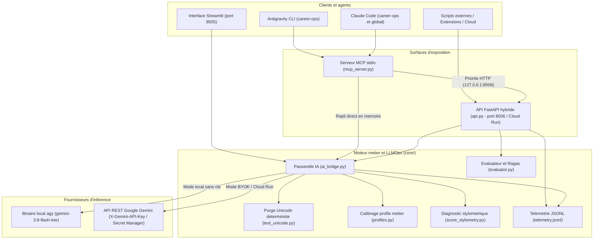

# Guide d'architecture: API hybride, serveur MCP et gouvernance LLMOps

Ce document décrit le fonctionnement opérationnel de la plateforme AI-remover dans sa configuration hybride: exécution locale via Antigravity CLI, exposition par API interne ou Google Cloud Run, intégration MCP dans `career-ops` et Claude Code, ainsi que surveillance du Harness par Golden Dataset, métriques Ragas et télémétrie structurée.

## Architecture globale et flux d'exécution

Le cœur métier réside intégralement dans le paquet `core/`, sans aucune dépendance envers l'interface graphique. Quatre surfaces consomment ce moteur commun selon le contexte d'usage.



## Politique de sélection des modèles et résilience

L'appel local via Antigravity CLI interroge dynamiquement la commande `agy models` au travers de `get_available_agy_models()` dans `core/ai_bridge.py`.

Trois garde-fous protègent l'application contre les dépassements de délai et les retraits de modèles:

### Filtrage exclusif des petits modèles

Seuls les modèles de la famille `flash` sont retenus (`gemini-3.8-flash-low`, `gemini-3.8-flash-medium`, `gemini-3.8-flash-high`). Les modèles à raisonnement lourd (Carbon, Argon, Sonnet, Opus) sont exclus d'office afin de maintenir le temps de réponse autour de quelques secondes et d'éviter le plafond de temporisation de 180 secondes. Le modèle `gemini-3.8-flash-low` est sélectionné en première position par défaut.

### Découverte dynamique sans liste figée

La liste des modèles n'est pas codée en dur comme unique source de vérité: chaque démarrage lit la sortie réelle du binaire `agy` installé sur le poste. Lorsqu'un ancien modèle est retiré par une mise à jour de la CLI, il disparaît automatiquement du sélecteur.

### Repli automatique en cas de modèle déprécié

Dans `_call_single_agy_turn()`, l'entrée standard du sous-processus est fermée (`stdin=subprocess.DEVNULL`) pour prévenir tout blocage d'entrée-sortie sous Windows. Si un identifiant de modèle provoque malgré tout une erreur `unknown model` ou `model not found`, la passerelle relance immédiatement la requête sans l'option `--model` afin que la CLI utilise son moteur actif par défaut.

## API hybride interne et Cloud Run

Le fichier `api.py` expose le moteur sous FastAPI. Sur votre machine, le serveur écoute sur le port dédié `8506` pour cohabiter sans conflit avec l'interface Streamlit (`8505`) et avec LyonFlow.

### Démarrage local de l'API

Sous Windows, exécutez le script `launch_api.bat` (qui libère automatiquement le port `8506` si une instance précédente tourne encore) ou lancez directement Uvicorn:

```powershell
uv run --with fastapi --with uvicorn --with requests uvicorn api:app --host 127.0.0.1 --port 8506
```

La documentation interactive OpenAPI est consultable sur `http://127.0.0.1:8506/docs`.

### Logique de routage hybride des clés d'API

Sur le point d'entrée `POST /api/v1/humanize`, la sélection du moteur suit cet ordre de priorité:

1. Si l'appelant fournit l'en-tête HTTP `X-Gemini-API-Key`, l'API bascule immédiatement sur l'API REST Google Gemini avec cette clé, sans jamais la stocker sur disque ni en mémoire globale.
2. Si aucun en-tête n'est transmis et que le binaire local `agy` est détecté sur la machine (`engine="auto"` ou `engine="agy"`), le traitement passe gratuitement par votre session locale Antigravity CLI.
3. Si `agy` est absent (cas d'un conteneur Google Cloud Run), l'API lit la variable d'environnement serveur `GEMINI_API_KEY`. Si aucune clé n'est disponible ni dans l'en-tête ni dans l'environnement, elle renvoie un code HTTP `401`.

### Référence des points d'entrée HTTP

| Méthode | Route | Rôle opérationnel |
| :--- | :--- | :--- |
| `GET` | `/health` | État du service, détection du binaire `agy` et moteur par défaut. |
| `GET` | `/api/v1/profiles` | Liste des 6 profils métier disponibles (`architecte`, `avocat`, `analyste`, etc.). |
| `GET` | `/api/v1/models` | Liste dynamique des petits modèles Flash disponibles. |
| `POST` | `/api/v1/humanize` | Réécriture complète avec scores stylométriques avant/après et bilan Unicode. |
| `POST` | `/api/v1/analyze` | Diagnostic stylométrique et comptage des caractères invisibles sans appel LLM. |
| `POST` | `/api/v1/clean-unicode` | Purge déterministe des points de code invisibles et des espaces exotiques. |
| `POST` | `/api/v1/evaluate` | Contrôle d'une réécriture face à une liste de faits obligatoires et de clichés interdits. |
| `GET` | `/api/v1/telemetry/summary` | Synthèse temps réel du Harness (appels, taux de succès, p50, p95, timeouts). |

### Exemples d'appels HTTP

Appel local sous PowerShell (utilise automatiquement Antigravity CLI sans clé):

```powershell
$body = @{
    text = "Fort de mon expérience à la croisée de la data et du MLOps, j'ai déployé Prophet chez Interflora avec un MAPE de 15 %."
    profile_id = "architecte"
    model = "gemini-3.8-flash-low"
} | ConvertTo-Json -Compress

Invoke-RestMethod -Method Post -Uri "http://127.0.0.1:8506/api/v1/humanize" -ContentType "application/json; charset=utf-8" -Body $body
```

Appel vers une instance Cloud Run avec injection de clé à la volée via `curl`:

```bash
curl -X POST "https://ai-remover-api-xxxx.ew.a.run.app/api/v1/humanize" \
  -H "Content-Type: application/json" \
  -H "X-Gemini-API-Key: AIzaSyVotreCleTemporaire..." \
  -d '{
    "text": "Il convient de souligner que ce pipeline joue un rôle crucial.",
    "profile_id": "architecte",
    "model": "gemini-3-flash-preview"
  }'
```

### Déploiement sur Google Cloud Run

Le `Dockerfile` situé à la racine construit une image légère basée sur `python:3.12-slim` (sans Playwright ni dépendances bureautiques lourdes) qui écoute sur le port injecté par Cloud Run (`$PORT`).

```bash
# Construction et envoi de l'image
gcloud builds submit --tag europe-west1-docker.pkg.dev/VOTRE_PROJET/containers/ai-remover-api:latest

# Déploiement en mode BYOK pur (chaque client fournit X-Gemini-API-Key)
gcloud run deploy ai-remover-api \
  --image europe-west1-docker.pkg.dev/VOTRE_PROJET/containers/ai-remover-api:latest \
  --region europe-west1 \
  --allow-unauthenticated

# Ou déploiement avec clé par défaut montée depuis Google Secret Manager
gcloud run deploy ai-remover-api \
  --image europe-west1-docker.pkg.dev/VOTRE_PROJET/containers/ai-remover-api:latest \
  --region europe-west1 \
  --set-secrets GEMINI_API_KEY=gemini-api-key-secret:latest \
  --allow-unauthenticated
```

## Serveur MCP `ai-remover` pour Antigravity et Claude Code

Le fichier `mcp_server.py` implémente un serveur Model Context Protocol sur transport `stdio` via `FastMCP`. Il force l'encodage UTF-8 sur `stdin`, `stdout` et `stderr` afin de préserver tous les accents français sous Windows.

### Outils MCP exposés aux agents

Le serveur met trois outils à disposition immédiate de vos sessions d'agents:

`humanize_text(text, profile_id="architecte", model="gemini-3.8-flash-low", custom_sample=None)`
Réécrit le texte fourni selon le profil demandé, purge les clichés d'IA, normalise la ponctuation et restitue le texte accompagné des scores stylométriques avant et après passage.

`analyze_ai_density(text)`
Calcule instantanément et sans appel LLM le score composite (0.0 à 1.0), la burstiness, la liste des tournures d'IA repérées et le nombre de caractères Unicode invisibles.

`clean_invisible_unicode(text)`
Nettoie de manière déterministe les caractères de largeur nulle (`U+200B`, `U+FEFF`) et remplace les espaces insécables par des espaces ASCII standards.

### Double transport résilient

Lorsque la variable `AI_REMOVER_API_URL` est renseignée (configurée sur `http://127.0.0.1:8506`), `mcp_server.py` interroge d'abord l'API interne (`transport: "http_api"`). Si vous pointez `AI_REMOVER_API_URL` vers votre URL Cloud Run accompagnée de `AI_REMOVER_API_KEY`, le même outil MCP route vers le cloud. Enfin, si le démon local sur le port `8506` est arrêté, le serveur MCP bascule automatiquement sur `core.ai_bridge.humanize_text` en mémoire (`transport: "direct_core"`): vos sessions `career-ops` et Claude Code ne tombent jamais en panne.

### Fichiers de configuration installés sur le poste

Pour Antigravity CLI sur le dépôt `career-ops` et en global:
1. Plugin projet: `C:\Users\Admin\Documents\career-ops\career-ops\.agents\plugins\ai-remover\plugin.json` et `mcp_config.json`.
2. Registre global Antigravity: `C:\Users\Admin\.gemini\config\mcp_config.json` (entrée `ai-remover`).
3. Règle métier persistante (protégée contre les mises à jour de `career-ops`): `C:\Users\Admin\Documents\career-ops\career-ops\modes\_custom.md`.

Pour Claude Code sur `career-ops`, sur `HENRI` et en global:
1. Fichiers de projet: `C:\Users\Admin\Documents\career-ops\career-ops\.mcp.json` et `C:\Users\Admin\Documents\HENRI\.mcp.json`.
2. Autorisations automatiques sans invite bloquante: `C:\Users\Admin\Documents\career-ops\career-ops\.claude\settings.json` (`mcp__ai-remover__humanize_text`, `mcp__ai-remover__analyze_ai_density`, `mcp__ai-remover__clean_invisible_unicode`).
3. Configuration utilisateur globale: `C:\Users\Admin\.claude.json`.

Commandes de vérification de l'état des serveurs MCP:

```powershell
agy mcp list
claude mcp list
```

## Gouvernance LLMOps: Golden Dataset, Ragas et observabilité

Pour empêcher toute perte de précision factuelle (oubli d'un chiffre, d'un outil ou d'une référence juridique) lors d'un changement de prompt ou de modèle, trois briques encadrent le Harness.

### Corpus de référence (`evals/golden_dataset.json`)

Le Golden Dataset réunit 9 cas métiers complets couvrant les profils `architecte` (réalisations MLOps Interflora, architectures multi-agents ITG Consultants, scraping distribué GL events, LTV Qonto et Michelin), `avocat` (clause de non-concurrence Cass. soc. 10 juillet 2002, rupture brutale L. 442-1, sous-traitance RGPD article 28) et `analyste` (arbitrage FinOps GPU Kubernetes). Chaque entrée définit le texte source saturé d'IA, une réécriture humaine de référence, la liste exacte des `required_facts` et la liste des `forbidden_cliches`.

### Moteur d'évaluation et intégration Ragas (`core/evaluator.py`)

La fonction `evaluate_transformation()` valide quatre portes de qualité cumulatives pour déclarer un test conforme (`passed = True`):
1. Rétention factuelle (`factual_retention == 1.0`): 100 % des faits, métriques, dates et composants techniques listés dans `required_facts` doivent figurer dans le texte produit.
2. Éradication des clichés (`cliche_eradication == 1.0`): aucune expression de `forbidden_cliches` ne doit subsister.
3. Hygiène Unicode (`unicode_hygiene == 1.0`): zéro caractère invisible, zéro espace insécable et zéro tiret cadratin ou demi-cadratin.
4. Plafond stylométrique (`score_after <= 0.45`): maintien du score composite en zone sobre.

En complément, `compute_ragas_non_llm_metrics()` calcule la proximité avec la référence humaine via Ragas (`SingleTurnSample`, `NonLLMStringSimilarity`, `RougeScore`) lorsque le paquet `ragas` est présent dans l'environnement, avec repli déterministe par score F1 lexical pour garantir l'exécution hors ligne dans GitHub Actions.

Exécution du banc d'évaluation:

```powershell
# Validation rapide hors ligne des references et des regles du Golden Dataset
uv run python evals/run_ragas_eval.py

# Evaluation reelle bout-en-bout sur le modele local Flash Low (2 premiers cas)
uv run python evals/run_ragas_eval.py --live --limit 2 --model gemini-3.8-flash-low

# Evaluation complete avec metriques Ragas natives
uv run --with ragas --with rapidfuzz python evals/run_ragas_eval.py --live --model gemini-3.8-flash-low
```

Le rapport détaillé est écrit à chaque passage dans `logs/eval_report.json`.

### Télémétrie et observabilité du Harness (`core/telemetry.py`)

Chaque exécution de `humanize_text()` enregistre un événement JSON Lines dans `logs/telemetry.jsonl` (désactivable via `AI_REMOVER_DISABLE_TELEMETRY=1` ou redirigeable via `AI_REMOVER_TELEMETRY_FILE`). Pendant les tests unitaires Pytest, le fichier `tests/conftest.py` isole automatiquement ces journaux vers un dossier temporaire afin de garder `logs/telemetry.jsonl` propre pour vos appels réels.

Chaque ligne trace `trace_id`, `timestamp`, `source` (`ui`, `api`, `mcp`, `eval`), `engine`, `model`, `profile_id`, `latency_ms`, `success`, `chars_in`, `chars_out`, `score_before`, `score_after`, `unicode_cleaned_count` et le message d'erreur éventuel (aucune clé API n'est jamais journalisée).

Consultation directe de la synthèse opérationnelle:

```powershell
Invoke-RestMethod -Uri "http://127.0.0.1:8506/api/v1/telemetry/summary" | ConvertTo-Json
```

## Qualité logicielle et maintenance courante

L'ensemble du dépôt est couvert par 69 tests automatisés sous Pytest et vérifié par Ruff.

```powershell
# Verification lint et formatage
uv run --with ruff ruff check .
uv run --with ruff ruff format --check .

# Execution complete des 69 tests unitaires et d'integration
uv run --with fastapi --with httpx --with fastmcp pytest -v
```
